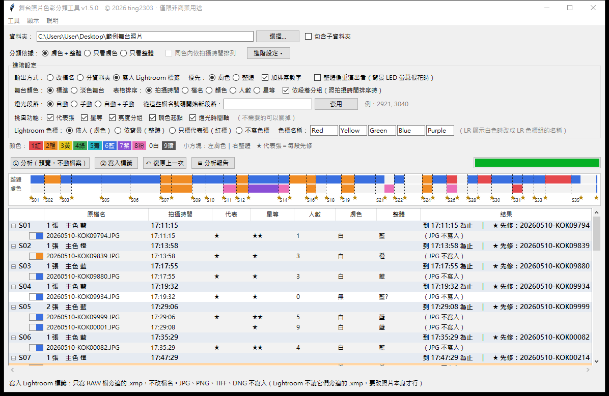
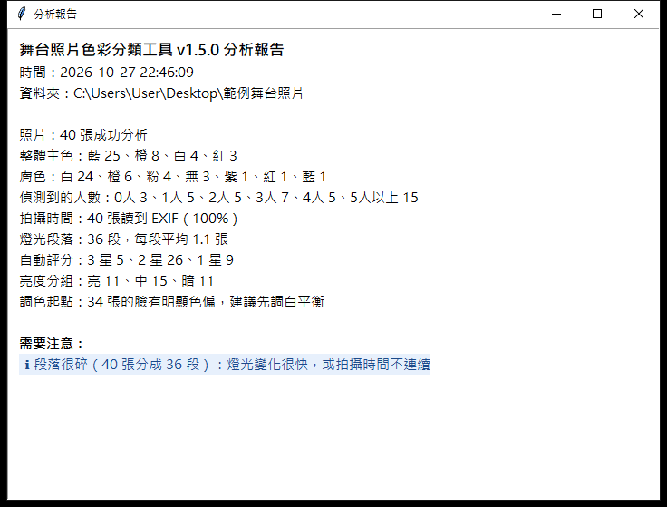

# 照片色彩分類工具

**中文** | [English](README.en.md)

拍舞台和演唱會時，燈光每隔幾秒就換一次顏色。回家修圖面對幾百張照片，最花時間的往往不是調色本身，而是先把「同一種燈光」的照片找出來。

這個工具會替你看每張照片：**臉被打成什麼顏色的光**，以及**整個畫面的主色**，然後把結果寫進檔名、把照片分到對應的資料夾，或寫成 Lightroom 的星等、色標和關鍵字（只限 RAW 檔）。匯入 Lightroom Classic 後依檔名排序或點色標篩選，同樣燈光的照片就會排在一起，調好一張就能同步給整組。


<sub>實際判斷結果（人臉已打馬賽克）。框線是偵測到的臉，底下依序是臉的顏色、整體主色，以及寫進檔名的前綴。</sub>

## 下載

### [⬇ 下載 PhotoColorSorter-Windows.zip（約 60 MB）](https://github.com/ting2303/photo-color-sorter/releases/latest/download/PhotoColorSorter-Windows.zip)

下載後在 ZIP 上按右鍵 →「解壓縮全部」，再執行資料夾裡的 `PhotoColorSorter.exe`。

> 請用上面的連結，或到 [Releases](https://github.com/ting2303/photo-color-sorter/releases/latest) 頁面下載。頁面上方綠色的「Code → Download ZIP」下載的是原始碼，裡面沒有 exe。

- 系統需求：Windows 10 或 11，不需要另外安裝 Python
- 第一次開啟時，Windows 可能顯示「已保護您的電腦」。這是因為程式沒有購買數位簽章，點「其他資訊」→「仍要執行」即可。若想確認檔案沒被改過，可以比對 Release 頁面上的 SHA-256（做法見 [SECURITY.md](SECURITY.md)）。
- 圖文教學：[使用教學.pdf](docs/使用教學.pdf)（4 頁，ZIP 裡也有一份）
- 每一版的變更：[CHANGELOG.md](CHANGELOG.md)

## 使用方式

> **請在匯入 Lightroom 之前使用，並先備份原始照片。** 照片匯入後若在外部改名，Lightroom 會找不到檔案。

1. 選擇照片資料夾
2. 按「① 分析」。這一步只會讀取照片，不會更動任何檔案
3. 在表格裡確認結果。切換上方選項時，最右欄會即時更新，不必重新分析
4. 按「② 執行改名」（輸出方式選分資料夾時是「② 執行分資料夾」、選寫入 Lightroom 標籤時是「② 寫入標籤」）
5. 如果不滿意，按「↶ 復原上一次」還原（之後被其他程式改過的檔案除外）

**想在 Lightroom 用色標篩選燈光顏色？** 按「進階設定 ▸」→「輸出方式」選「寫入 Lightroom 標籤」→「Lightroom 色標」選依人或依背景 → 按「② 寫入標籤」。詳細步驟見[寫入 Lightroom 標籤](#寫入-lightroom-標籤)。

也可以直接把資料夾拖到 `PhotoColorSorter.exe` 的圖示上，程式開啟後會自動開始分析。


### 輸出方式

| 方式 | 處理前 | 處理後 |
|---|---|---|
| 改檔名 | `DSC_1234.JPG` | `8粉6藍_DSC_1234.JPG` |
| 分資料夾 | `DSC_1234.JPG` | `膚色8粉\整體6藍\DSC_1234.JPG` |
| 寫入 Lightroom 標籤 | `DSC_1234.ARW` | 檔名不變；旁邊的 `DSC_1234.xmp` 寫入星等、色標和「舞台色彩」關鍵字（只有 RAW，見[下方](#寫入-lightroom-標籤)） |

以 `8粉6藍_` 為例：前半 `8粉` 是臉的顏色，後半 `6藍` 是整體主色。

### 顏色代碼

| 代碼 | 意思 |
|---|---|
| `0白` | 白光；若出現在臉的位置，代表膚色正常、沒被有色光染到 |
| `1紅` `2橙` `3黃` `4綠` `5青` `6藍` `7紫` `8粉` | 被該顏色的燈光照到 |
| `9暗` | 畫面或臉部太暗，無法判斷 |
| `無` | 沒偵測到臉（背對鏡頭、臉太小或太暗），只會出現在臉的位置 |

數字只用來排序。Lightroom 依檔名排列時會照 0 → 9 的順序，大致就是白光在前、接著依彩虹色排列，「無」排在最後。

### 選項

| 選項 | 說明 |
|---|---|
| 分類依據（主畫面） | 同時看臉和整體，或只看其中一項 |
| 同色內依拍攝時間排列（主畫面） | 在顏色後面加拍攝時間序號（例如 `8粉_0012_DSC02921.ARW`），同一個顏色裡照 EXIF 拍攝時間排，相機編號跳回 0001 也不會亂；用兩台相機時，兩台的時鐘要先對齊。搭配「只看膚色」或「只看整體」，就是先分一種顏色、再照時間排 |
| 包含子資料夾（資料夾欄旁） | 連子資料夾一起處理，已經分好的顏色資料夾會自動略過 |
| 優先（進階設定） | 決定臉或整體放在前面，也就是排序時先依哪一項分組 |
| 加排序數字（進階設定） | 取消勾選後檔名更短（例如 `粉藍_`），同色照片仍會排在一起，只是不照彩虹順序 |

### 在 Lightroom Classic 裡排序

在「圖庫」模組按 `G` 切到格線檢視，下方工具列的「排序方式」選「檔案名稱」。

只想處理某一種光時，可以用「圖庫過濾器 → 文字 → 檔案名稱」輸入例如 `6藍`，調好其中一張再同步到其他照片。

## 寫入 Lightroom 標籤

進階設定的「輸出方式」選「**寫入 Lightroom 標籤**」，按「② 寫入標籤」：**不改檔名**，把結果寫進 RAW 旁邊的 `.xmp`，匯入 Lightroom 後直接有：

| 寫入的內容 | 在 Lightroom 怎麼用 |
|---|---|
| 星等 1～3 | 格線上的星星、過濾器的星等 |
| 色標 | 圖庫上方的過濾器列切到「屬性」，點色標篩燈光顏色（見下方「依人／依背景」） |
| 關鍵字 `舞台色彩` 底下的 膚色／整體／段落／人數（5 人以上合併為「5人以上」）／亮度／代表張 | 關鍵字清單點箭頭篩選；不要時整組刪掉「舞台色彩」即可 |

- **色標依人或依背景**：「Lightroom 色標」選「依人」用臉被照到的顏色、「依背景」用整體主色。Lightroom 只有 5 種色標，所以橙併入黃、青併入綠、粉併入紫；白光、太暗、沒有臉不加色標。也可以選「只標代表張」（紅標）或「不寫色標」
- **色標顯示成白色？** Lightroom 是用色標「名稱」比對的，非英文版或自訂的色標組名稱可能不同。到 Lightroom「中繼資料 → 色標組 → 編輯」看五個名稱，照**紅、黃、綠、藍、紫**的順序填到程式進階設定的「色標名稱」五個欄位
- **已有的星等和色標會保留**，只補空的；`.xmp` 裡原本的修圖設定和你自己的關鍵字，本工具不會改
- **只寫 RAW（DNG 除外）**：Lightroom 不讀 JPG、PNG、TIFF、BMP、WebP、DNG 旁邊的 `.xmp`（要寫進照片本身），為了不動照片，這些格式不寫入，請改用「改檔名」
- **已經匯入的照片，順序很重要**：
  1. 先在 Lightroom 選取這些照片，按「中繼資料 → 將中繼資料儲存至檔案」（Ctrl+S），把你在 Lightroom 裡的修圖和星等存進 `.xmp`
  2. 用本工具寫入標籤
  3. 回到 Lightroom，選取同一批照片 →「中繼資料 → 從檔案讀取中繼資料」

  ⚠ 少了第 1 步的話，第 3 步會用 `.xmp` 的內容**蓋掉 Lightroom 目錄裡還沒存進檔案的修圖和星等**。另外，Lightroom 開著「自動將變更寫入 XMP」時，可能會蓋掉本工具寫的內容
- 「↶ 復原上一次」可以還原：本工具新建的 `.xmp` 會刪掉，原本就有的會一字不差地還原；寫入後被 Lightroom 改過的檔案不會動

## 挑圖輔助

分析完成後，表格還會多出幾欄，幫你決定先修哪幾張。這些資訊不會寫進檔名；選「寫入 Lightroom 標籤」時，星等、段落、人數、亮度、代表張會寫成 Lightroom 的星等和關鍵字。

| 欄位 | 說明 |
|---|---|
| 拍攝時間 | 從照片的 EXIF 讀取；讀不到時用檔案時間，後面會加 `*` |
| 段落 | 依拍攝時間與燈光切開的區段（S01、S02…）。停頓超過 60 秒、或燈光換色就換段 |
| 代表 | ★ 是每段最適合先修的一張（清楚、臉大、亮度適中）。修好它再同步給整段 |
| 清晰度 | 整批照片之間的相對分數 0～100，越高越清楚 |
| 整體後的 `?` | 主色票數偏低，畫面顏色很雜，建議人工確認 |
| 星等 | 自動初篩 1～3 星（整批相對比較）：1 星 = 沒有臉、臉太暗或可能模糊，3 星 = 清楚、臉夠大、曝光正常 |
| 人數 | 偵測到幾張臉（寫入 Lightroom 時 5 人以上合併為「5人以上」）。只判斷「有沒有人、有幾個人」，不辨認是誰、也不比對是不是同一個人。遠處太小、背對或太暗的臉不會算進去 |
| 亮度 | 亮／中／暗：臉的亮度和整批最亮的照片比。同一首歌追光忽亮忽暗時，可以分開同步 |
| 調色起點 | 臉的色偏方向與強度，例如「色溫+20 色調-12」= 往暖、往綠調。只是建議，不會寫入檔案，數字也不是 Lightroom 滑桿的精確值 |

畫面上只留最常用的設定；其他選項在「進階設定」（按「進階設定 ▸」展開），不常用的工具在選單「工具」，完整欄位在「顯示 → 顯示所有欄位」。

進階設定裡可以手動調整：



- **燈光段落：自動／手動／自動＋手動**：輸入檔名號碼（例如 `2921, 3040, 3074`），從那幾張開始新段落。找不到完全相同的號碼時，用號碼比它大、最接近的那張；完全找不到的號碼會在狀態列列出
- **舞台顏色：標準／淡色舞台**：整場燈光顏色很淡、大部分照片被判成白時可以試「淡色舞台」。代價是真正的白光場景會被判成有色，而且修過色的成品照容易把膚色當成紅光，所以請和「標準」的結果比較後再用。分析報告會提醒
- **挑圖功能**：代表張、星等、亮度分組、調色起點、燈光時間軸可以各自打開或關閉。用不到的關掉，畫面更乾淨
- **輸出方式、Lightroom 色標**：見上方「[寫入 Lightroom 標籤](#寫入-lightroom-標籤)」

上次的設定會自動記住（存在使用者資料夾的 `.photo_color_sorter.json`），下次開啟時不必重選。

閱讀輔助：

- 照拍攝時間排序時，表格依段落分組，每段一個標題列（張數、主色、時間、先修哪一張），可以展開或收合
- 每列左邊有一個小方塊：左半是膚色、右半是整體主色；圖例也用色塊表示
- 表格上方的**燈光時間軸**色帶顯示整場燈光變化，點一下就跳到那一段。超過 10 分鐘的停頓（中場休息、相機時間設錯）會壓縮，不會把其他照片擠在一起
- 分析報告的提醒依輕重上色：⚠ 需要注意、ℹ 參考、✓ 正常

其他選項：

- **整體偏重演出者**：背景 LED 螢幕很花時勾選，演出者周圍的顏色會比背景更重要
- **表格排序**：可以照拍攝時間、檔名、顏色、人數或星等排列（關掉的功能不能拿來排序）
- **開啟照片**：點表格的「原檔名」用預設的看圖程式開啟；按右鍵可以在檔案總管中顯示
- **匯出 CSV**：把整張表存進照片資料夾，可以用 Excel 開啟
- **燈光時間軸大視窗**：選單「工具 → 燈光時間軸」，放大顯示整場的燈光變化、段落交界和代表張
- **分析報告**：整批的統計，以及這次結果需要注意的地方（例如「大部分判成白」「沒有拍攝時間」「很多照片沒偵測到臉」）與建議的調整方式。分析完成時，狀態列也會提示有幾項需要注意



## 修圖後還原檔名

用 RAW 修圖、輸出 JPG 之後，輸出的檔名通常還帶著顏色前綴，而且修圖軟體常會在後面加字，例如 `8粉_0012_DSC02921-Enhanced-NR.jpg`。

在程式裡選擇「輸出的資料夾」，按選單「工具 → 還原修圖後檔名…」，就會改成 `DSC02921-Enhanced-NR.jpg`：只拿掉本工具加的那段，後面的字保留。改回原本的檔名後，依檔名排序就回到拍攝順序。

- 輸出資料夾和原始照片不在同一個地方時，程式會請你選原始照片的資料夾。它會讀那裡的改名紀錄來比對，最準確，而且**只會動紀錄裡的照片**，自己取名的檔案（例如 `白_婚禮.jpg`）不會被改到
- 找不到任何紀錄時，才用規則移除開頭的顏色前綴
- 執行前會先列出要改的檔案；改完可以按「復原上一次」改回來

## 判斷方式

- **人臉偵測**：使用 OpenCV 的 [YuNet](https://github.com/opencv/opencv_zoo/tree/main/models/face_detection_yunet) 模型找出臉的位置。偵測時看的是形狀而不是顏色，所以比較不受燈光顏色影響，遠處的小臉也抓得到；但太暗、背對或很小的臉仍可能漏掉。它只判斷「哪裡有臉」，不會辨識是誰。
- **臉的顏色**：統計每張臉中央區域的色相，取佔比最高的顏色。臉越大、偵測越確定，影響越大。
- **整體主色**：略過黑暗的部分，以亮處的有色光為主統計。燈光爆點、星芒和過曝的白衣服（很亮又幾乎沒顏色）不參與投票，避免幾個爆點就把整張照片判成白；爆點佔亮處越多（2 成到 5 成之間），它們的票數就逐步恢復，所以大片過曝的白光場景仍會判成白。表格的「燈光爆點」欄顯示爆點佔亮處的比例。

這是自動判斷，難免有誤，例如背景圖案被當成臉，或偏冷的白光被判成藍色。判斷的靈敏度可以在 `photo_color_sorter.py` 開頭調整。

## 常見問題

**會不會弄壞照片？**
不會。程式不修改照片內容，也不刪除照片。改檔名、分資料夾只是改名或搬移；寫入 Lightroom 標籤只會新增或修改 RAW 旁邊的 `.xmp`（復原時會刪掉它自己新建的 `.xmp`）。每次執行都會留下紀錄，可以復原；被其他程式移動或修改過的檔案例外（見[免責聲明](DISCLAIMER.md)）。

**照片已經匯入 Lightroom 了還能用嗎？**
不要用「改檔名」或「分資料夾」（Lightroom 會找不到檔案）。RAW 可以用「寫入 Lightroom 標籤」，但請照[這裡的順序](#寫入-lightroom-標籤)：先在 Lightroom 儲存中繼資料，再寫入，最後從檔案讀取中繼資料。

**照片會被上傳嗎？**
不會。所有處理都在你的電腦上完成，程式不連網路。

**支援哪些格式？**
JPG、PNG、TIFF、BMP、WebP，以及 Canon、Nikon、Sony、Fujifilm 等主流相機的 RAW 檔。同名的 RAW、JPG、XMP 會一起處理。

**照片放在網路磁碟上很慢？**
先複製到本機硬碟再分析會比較快。作為參考，825 張 JPG 放在網路磁碟上，分析大約花 3～5 分鐘（隨網路狀況變動）。

**有 Mac 版嗎？**
目前只有 Windows 版。

<details>
<summary><b>從原始碼執行、命令列與開發</b></summary>

需要 Python 3.10 以上：

```bash
pip install -r requirements.txt
python photo_color_sorter.py
```

命令列用法：

```bash
python photo_color_sorter.py "D:\照片\活動" --preview                  # 預覽改檔名
python photo_color_sorter.py "D:\照片\活動" --preview --output folder  # 預覽分資料夾
python photo_color_sorter.py "D:\照片\活動" --apply                    # 實際執行
python photo_color_sorter.py "D:\照片\活動" --apply --output xmp --label main   # 寫入 Lightroom 標籤，色標依背景
```

其他參數：`--mode both|skin|main`、`--order skin|main`、`--no-digits`、`-r`（含子資料夾）、`--performer`、`--time-seq`、`--stage standard|pale`、`--scenes auto|manual|both --splits "2921,3040"`、`--csv 結果.csv`、`--report [報告.txt]`、`--label skin|main|rep|none`、`--label-names "Red,Yellow,Green,Blue,Purple"`

還原修圖後檔名：`python photo_color_sorter.py "D:\輸出" --restore --log-folder "D:\照片\活動" --apply`

復原上一次：`python photo_color_sorter.py "D:\照片\活動" --undo`

開發：

```bash
python -m unittest discover tests   # 執行測試
build_exe.bat                       # 打包成 exe，輸出到 dist\PhotoColorSorter
python docs\build_tutorial.py       # 重新產生教學 PDF
python tools\mutation_check.py      # 故意把功能改壞，確認測試抓得到
```

校正判斷準確度：`python tools\label_tool.py 照片資料夾` 一張張標正確顏色（存成資料夾裡的 `labels.csv`），再用 `python tools\evaluate.py 照片資料夾` 產生準確率報告。

</details>

## 安全性

改名、寫入 `.xmp` 和復原都只會發生在你選的資料夾內（設定檔另外存在使用者資料夾）；改名時不會覆蓋既有檔案；復原紀錄若被改過、指向資料夾以外的位置，程式會拒絕執行。細節見 [SECURITY.md](SECURITY.md)。如果發現安全問題，請透過本頁的 **Security → Report a vulnerability** 私下回報。

## 授權

本專案採用 [PolyForm Noncommercial License 1.0.0](LICENSE)，© 2026 ting2303。

| 允許 | 不允許 |
|---|---|
| 個人使用，包括整理自己接案拍的照片 | 販售本工具或修改後的版本 |
| 學校、社團、非營利組織使用 | 把本工具放進付費產品或服務 |
| 閱讀、修改原始碼並以非商業方式分享 | 移除 LICENSE 中的作者聲明 |

需要商業授權，請透過 GitHub 聯絡 [ting2303](https://github.com/ting2303)。

使用前請先閱讀[免責聲明](DISCLAIMER.md)。第三方元件的授權見 [THIRD_PARTY_NOTICES.md](THIRD_PARTY_NOTICES.md)。Adobe 與 Lightroom 是 Adobe Inc. 的商標，本專案與 Adobe 無關。

---

如果這個工具幫你省了一些時間，歡迎在頁面右上角按個 Star，或到 [Issues](https://github.com/ting2303/photo-color-sorter/issues) 告訴我哪裡可以改進。
