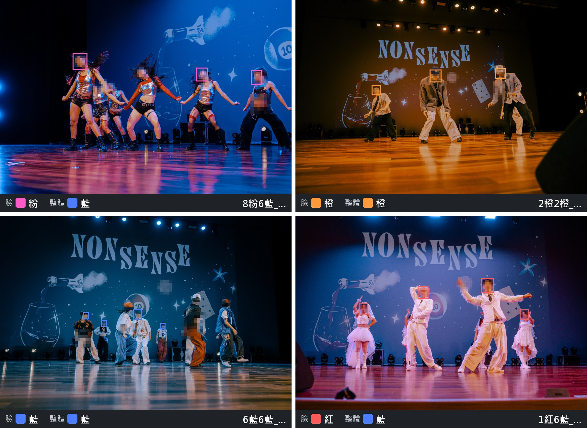
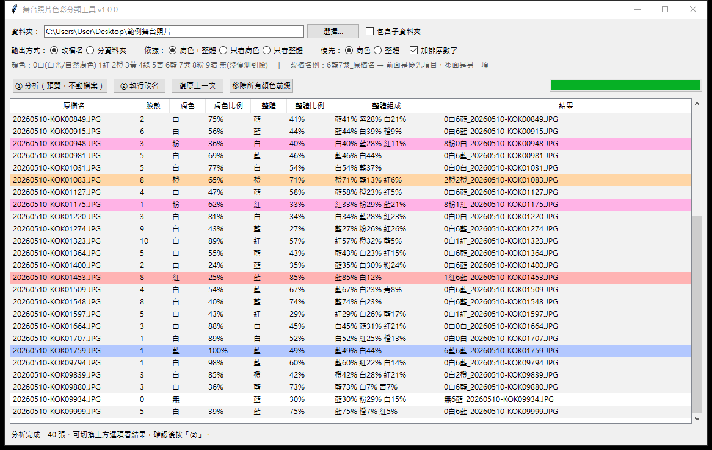

# 照片色彩分類工具

**中文** | [English](README.en.md)

拍舞台和演唱會時，燈光每隔幾秒就換一次顏色。回家修圖面對幾百張照片，最花時間的往往不是調色本身，而是先把「同一種燈光」的照片找出來。

這個工具會替你看每張照片：**臉被打成什麼顏色的光**，以及**整個畫面的主色**，然後把結果寫進檔名，或把照片分到對應的資料夾。匯入 Lightroom Classic 後依檔名排序，同樣燈光的照片就會排在一起，調好一張就能同步給整組。



<sub>實際判斷結果（人臉已打馬賽克）。框線是偵測到的臉，底下依序是臉的顏色、整體主色，以及寫進檔名的前綴。</sub>

## 下載

### [⬇ 下載 PhotoColorSorter-Windows.zip（約 60 MB）](https://github.com/ting2303/photo-color-sorter/releases/latest/download/PhotoColorSorter-Windows.zip)

下載後在 ZIP 上按右鍵 →「解壓縮全部」，再執行資料夾裡的 `PhotoColorSorter.exe`。

> 請用上面的連結，或到 [Releases](../../releases/latest) 頁面下載。頁面上方綠色的「Code → Download ZIP」下載的是原始碼，裡面沒有 exe。

- 系統需求：Windows 10 或 11，不需要另外安裝 Python
- 第一次開啟時，Windows 可能顯示「已保護您的電腦」。這是因為程式沒有購買數位簽章，點「其他資訊」→「仍要執行」即可。若想確認檔案沒被改過，可以比對 Release 頁面上的 SHA-256（做法見 [SECURITY.md](SECURITY.md)）。
- 圖文教學：[使用教學.pdf](docs/使用教學.pdf)（3 頁，ZIP 裡也有一份）

## 使用方式

> **請在匯入 Lightroom 之前使用，並先備份原始照片。** 照片匯入後若在外部改名，Lightroom 會找不到檔案。

1. 選擇照片資料夾
2. 按「① 分析」。這一步只會讀取照片，不會更動任何檔案
3. 在表格裡確認結果。切換上方選項時，最右欄會即時更新，不必重新分析
4. 按「② 執行」
5. 如果不滿意，按「復原上一次」就會恢復原狀

也可以直接把資料夾拖到 `PhotoColorSorter.exe` 的圖示上，程式開啟後會自動開始分析。



### 輸出方式

| 方式 | 處理前 | 處理後 |
|---|---|---|
| 改檔名 | `DSC_1234.JPG` | `8粉6藍_DSC_1234.JPG` |
| 分資料夾 | `DSC_1234.JPG` | `膚色8粉\整體6藍\DSC_1234.JPG` |

以 `8粉6藍_` 為例：前半 `8粉` 是臉的顏色，後半 `6藍` 是整體主色。

### 顏色代碼

| 代碼 | 意思 |
|---|---|
| `0白` | 白光；若出現在臉的位置，代表膚色正常、沒被有色光染到 |
| `1紅` `2橙` `3黃` `4綠` `5青` `6藍` `7紫` `8粉` | 被該顏色的燈光照到 |
| `9暗` | 畫面或臉部太暗，無法判斷 |
| `無` | 沒偵測到臉（背對鏡頭、臉太小或太暗），只會出現在臉的位置 |

數字只用來排序。Lightroom 依檔名排列時會照 0 → 9 的順序，大致就是白光在前、接著依彩虹色排列，「無」排在最後。

### 選項

| 選項 | 說明 |
|---|---|
| 依據 | 同時看臉和整體，或只看其中一項 |
| 優先 | 決定臉或整體放在前面，也就是排序時先依哪一項分組 |
| 加排序數字 | 取消勾選後檔名更短（例如 `粉藍_`），同色照片仍會排在一起，只是不照彩虹順序 |
| 包含子資料夾 | 連子資料夾一起處理，已經分好的顏色資料夾會自動略過 |
| 同色內依拍攝時間排列 | 在顏色後面加拍攝時間序號（例如 `8粉_0012_DSC02921.ARW`），同一個顏色裡一定照拍攝時間排，兩台相機或編號跳回 0001 也不會亂。搭配「只看膚色」或「只看整體」，就是先分一種顏色、再照時間排 |

### 在 Lightroom Classic 裡排序

在「圖庫」模組按 `G` 切到格線檢視，下方工具列的「排序方式」選「檔案名稱」。

只想處理某一種光時，可以用「圖庫過濾器 → 文字 → 檔案名稱」輸入例如 `6藍`，調好其中一張再同步到其他照片。

## 挑圖輔助

分析完成後，表格還會多出幾欄，幫你決定先修哪幾張。這些資訊只顯示在表格裡，不會寫進檔名，「② 執行」的結果和以前一樣。

| 欄位 | 說明 |
|---|---|
| 拍攝時間 | 從照片的 EXIF 讀取；讀不到時用檔案時間，後面會加 `*` |
| 段落 | 依拍攝時間與燈光切開的區段（S01、S02…）。停頓超過 60 秒、或燈光換色就換段 |
| 代表 | ★ 是每段最適合先修的一張（清楚、臉大、亮度適中）。修好它再同步給整段 |
| 清晰度 | 整批照片之間的相對分數 0～100，越高越清楚 |
| 整體後的 `?` | 主色票數偏低，畫面顏色很雜，建議人工確認 |
| 星等 | 自動初篩 1～3 星（整批相對比較）：1 星 = 沒有臉或可能模糊，3 星 = 清楚、臉夠大、曝光正常 |
| 人物 | 同一人歸成同一組（P1 照片最多）。只判斷兩張臉像不像，不辨識是誰。濃妝、側臉、臉太小時可能把同一人拆成兩組 |
| 亮度 | 亮／中／暗：和同一個人最亮的照片比。同一首歌追光忽亮忽暗時，可以分開同步 |
| 調色起點 | 臉的色偏方向與強度，例如「色溫+20 色調-12」= 往暖、往綠調。只是建議，不會寫入檔案，數字也不是 Lightroom 滑桿的精確值 |

其他新選項：

- **整體偏重演出者**：背景 LED 螢幕很花時勾選，演出者周圍的顏色會比背景更重要
- **表格排序**：可以照拍攝時間、檔名或顏色排列
- **匯出 CSV**：把整張表存進照片資料夾，可以用 Excel 開啟
- **燈光時間軸**：用一條時間軸顯示整場的燈光變化、段落交界和代表張
- **分析報告**：整批的統計，以及這次結果需要注意的地方（例如「大部分判成白」「沒有拍攝時間」「很多照片沒偵測到臉」）與建議的調整方式。分析完成時，狀態列也會提示有幾項需要注意

## 修圖後還原檔名

用 RAW 修圖、輸出 JPG 之後，輸出的檔名通常還帶著顏色前綴，而且修圖軟體常會在後面加字，例如 `8粉_0012_DSC02921-Enhanced-NR.jpg`。

在程式裡選擇「輸出的資料夾」，按「還原修圖後檔名」，就會改成 `DSC02921-Enhanced-NR.jpg`：只拿掉本工具加的那段，後面的字保留。改回原本的檔名後，依檔名排序就回到拍攝順序。

- 輸出資料夾和原始照片不在同一個地方時，程式會請你選原始照片的資料夾。它會讀那裡的改名紀錄來比對，最準確，而且**只會動紀錄裡的照片**，自己取名的檔案（例如 `白_婚禮.jpg`）不會被改到
- 找不到任何紀錄時，才用規則移除開頭的顏色前綴
- 執行前會先列出要改的檔案；改完可以按「復原上一次」改回來

## 判斷方式

- **人臉偵測**：使用 OpenCV 的 [YuNet](https://github.com/opencv/opencv_zoo/tree/main/models/face_detection_yunet) 模型找出臉的位置。偵測時不看顏色，所以不會被燈光干擾，遠處的小臉也抓得到。它只判斷「哪裡有臉」，不會辨識是誰。
- **臉的顏色**：統計每張臉中央區域的色相，取佔比最高的顏色。臉越大、偵測越確定，影響越大。
- **整體主色**：略過黑暗的部分，以亮處的有色光為主統計。燈光爆點、星芒和過曝的白衣服（很亮又幾乎沒顏色）不參與投票，避免幾個爆點就把整張照片判成白；爆點佔亮處越多（2 成到 5 成之間），它們的票數就逐步恢復，所以大片過曝的白光場景仍會判成白。表格的「燈光爆點」欄顯示爆點佔亮處的比例。

這是自動判斷，難免有誤，例如背景圖案被當成臉，或偏冷的白光被判成藍色。判斷的靈敏度可以在 `photo_color_sorter.py` 開頭調整。

## 常見問題

**會不會弄壞照片？**
不會。程式只改檔名或搬移檔案，不修改照片內容，也不刪除任何檔案。每次執行都會留下紀錄，可以完整復原。

**照片會被上傳嗎？**
不會。所有處理都在你的電腦上完成，程式不連網路。

**支援哪些格式？**
JPG、PNG、TIFF，以及 Canon、Nikon、Sony、Fujifilm 等主流相機的 RAW 檔。同名的 RAW、JPG、XMP 會一起處理。

**照片放在網路磁碟上很慢？**
先複製到本機硬碟再分析會比較快。作為參考，825 張 JPG 放在網路磁碟上，分析大約花 2 分鐘。

**有 Mac 版嗎？**
目前只有 Windows 版。

<details>
<summary><b>從原始碼執行、命令列與開發</b></summary>

需要 Python 3.10 以上：

```bash
pip install -r requirements.txt
python photo_color_sorter.py
```

命令列用法：

```bash
python photo_color_sorter.py "D:\照片\活動" --preview                  # 預覽改檔名
python photo_color_sorter.py "D:\照片\活動" --preview --output folder  # 預覽分資料夾
python photo_color_sorter.py "D:\照片\活動" --apply                    # 實際執行
```

其他參數：`--mode both|skin|main`、`--order skin|main`、`--no-digits`、`-r`（含子資料夾）

開發：

```bash
python -m unittest discover tests   # 執行測試
build_exe.bat                       # 打包成 exe，輸出到 dist\PhotoColorSorter
python docs\build_tutorial.py       # 重新產生教學 PDF
```

</details>

## 安全性

改名和復原都只會發生在你選的資料夾內，不會覆蓋既有檔案；復原紀錄若被改過、指向資料夾以外的位置，程式會拒絕執行。細節見 [SECURITY.md](SECURITY.md)。如果發現安全問題，請透過本頁的 **Security → Report a vulnerability** 私下回報。

## 授權

本專案採用 [PolyForm Noncommercial License 1.0.0](LICENSE)，© 2026 ting2303。

| 允許 | 不允許 |
|---|---|
| 個人使用，包括整理自己接案拍的照片 | 販售本工具或修改後的版本 |
| 學校、社團、非營利組織使用 | 把本工具放進付費產品或服務 |
| 閱讀、修改原始碼並以非商業方式分享 | 移除 LICENSE 中的作者聲明 |

需要商業授權，請透過 GitHub 聯絡 [ting2303](https://github.com/ting2303)。

使用前請先閱讀[免責聲明](DISCLAIMER.md)。第三方元件的授權見 [THIRD_PARTY_NOTICES.md](THIRD_PARTY_NOTICES.md)。Adobe 與 Lightroom 是 Adobe Inc. 的商標，本專案與 Adobe 無關。

---

如果這個工具幫你省了一些時間，歡迎在頁面右上角按個 Star，或到 [Issues](../../issues) 告訴我哪裡可以改進。
